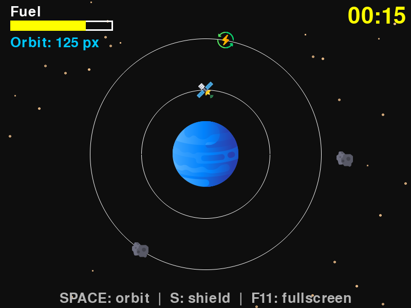
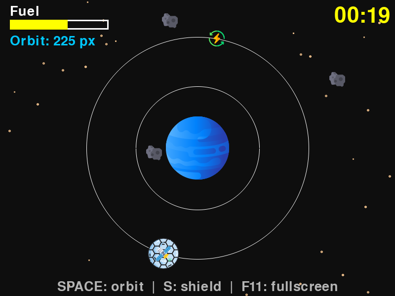
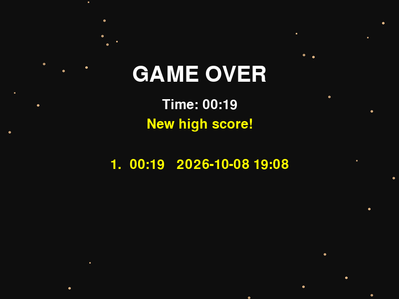

# Orbit Mania

An arcade game about switching orbits around a planet, written in Python with Pygame.



Your satellite circles a planet on one of two orbits. Asteroids drift in from
the right and energy packets appear on the orbits. Switch orbits to dodge
asteroids and collect packets, raise the shield when you can't dodge, and
don't run out of fuel. Your score is how long you survive.

## How to play

| Key | Action |
|---|---|
| `Space` | Switch between the inner and the outer orbit |
| `S` (hold) | Raise the shield |
| `F11` | Switch between window and fullscreen |
| `Esc` | Quit |

| Rule | Detail |
|---|---|
| Orbits | Inner 125 px, outer 225 px. A switch takes about 4 seconds; pressing `Space` again mid-switch does nothing |
| Fuel | Drains all the time, four times faster with the shield up. Each energy packet refills 20 % |
| Shield | Destroys any asteroid it touches and widens your reach for packets |
| Asteroids | Hitting one without the shield ends the game |
| Difficulty | Over the first minute, asteroids come more often (every 3 s → every 0.75 s) and faster |
| Game over | Hit by an asteroid, or out of fuel |

|  |  |
|---|---|
| Shield up | Game over screen with your high scores |

## Setup

Requires Python 3.10 or newer.

```bash
git clone https://github.com/adibatic/orbit-mania.git
cd orbit-mania
python3 -m venv .venv
source .venv/bin/activate          # Windows: .venv\Scripts\activate
pip install -r requirements.txt
```

## Play

```bash
PYTHONPATH=src python -m orbit_mania
```

Or install it once with `pip install -e .` and then just run `orbit-mania`.
Add options after either command:

| Option | Effect |
|---|---|
| `--fullscreen` | Start in fullscreen (`F11` switches back) |
| `--seed N` | Fix the asteroid and packet pattern, so the same inputs give the same game |
| `--scores PATH` | Save high scores to `PATH` instead of the default location |

The window opens at 3/4 of your screen height (never smaller than 800 × 600).
The game is always drawn at 800 × 600 and smoothly scaled to fill the window
or, in fullscreen, the whole screen, keeping its shape.

## High scores

Every finished game is added to your personal top 10, shown on the game over
screen; your best time also appears under the clock while you play. Quitting
with `Esc` does not count.

Scores are saved on your own computer, outside the project folder, so they
survive updates and are never committed:

| System | File |
|---|---|
| Linux | `~/.local/share/orbit-mania/highscores.json` |
| macOS | `~/Library/Application Support/orbit-mania/highscores.json` |
| Windows | `%APPDATA%\orbit-mania\highscores.json` |

To keep them somewhere else, use `--scores PATH` or set `ORBIT_MANIA_SCORES`.
Delete the file to reset your scores.

## How it works

```
keyboard ──▶ app.py ──(switch, shield)──▶ game.py ──▶ new state + events
               ▲                                            │
               └──── draw frame, HUD, sounds ◀──────────────┘      60 times per second
```

| Module | Role |
|---|---|
| `src/orbit_mania/game.py` | The rules, with no graphics: ship motion, fuel, spawning, difficulty, collisions. One call to `Game.step()` is one frame |
| `src/orbit_mania/app.py` | The Pygame window: keyboard input, drawing, HUD, game over screen |
| `src/orbit_mania/assets.py` | Loads sprites, sounds and fonts from `assets/` and draws the starfield background; runs silently if there is no audio device |
| `src/orbit_mania/scores.py` | Saves and ranks your best times |
| `src/orbit_mania/assets/` | Sprites and sounds (see Licence and credits) |

The ship moves at a constant angular speed (0.8° per frame). During an orbit
switch its radius changes at a constant 0.44 px per frame. All distances are
in pixels and all rates are per frame, at 60 frames per second.

Keeping the rules separate from the drawing means they can be tested without
opening a window.

## Tests

```bash
pytest
```

The tests check the rules (start position, constant angular speed, switch
duration, fuel drain, shield, crashes, refuelling, difficulty ramp, spawn
schedule, same seed gives the same game), the high-score file (ranking, top
10, damaged or unwritable files), the starfield, and run the real Pygame
window headless, including the window size and the fullscreen switch. They never touch your real
high-score file.

To redraw the screenshots in `docs/images/` after changing the look of the
game:

```bash
python scripts/make_screenshots.py
```

It plays a fixed demo game without opening a window and uses a temporary
high-score file.

## Project structure

```
orbit-mania/
├── src/orbit_mania/
│   ├── game.py          rules (no graphics)
│   ├── app.py           Pygame window and main loop
│   ├── assets.py        asset loading and starfield background
│   ├── scores.py        high scores
│   ├── assets/          sprites and sounds
│   ├── __main__.py      python -m orbit_mania
│   └── __init__.py
├── tests/
│   ├── test_game.py     rules
│   ├── test_scores.py   high scores
│   └── test_app.py      headless window run, starfield, fullscreen
├── scripts/
│   └── make_screenshots.py   redraws docs/images/
├── docs/images/         screenshots for this README
├── LICENSE
├── pyproject.toml
├── requirements.txt
└── README.md
```

## Licence and credits

The source code is under the MIT licence (see `LICENSE`), including the
starfield background, which is drawn by the code. The MIT licence does not
cover the sprites and sounds in `src/orbit_mania/assets/`; each keeps the
licence of its source:

| Asset | Credit |
|---|---|
| `activate_shield.mp3` | [Glass Hit](https://pixabay.com/sound-effects/film-special-effects-glass-hit-192119/) by Universfield via Pixabay |
| `background_music.mp3` | [Music for Arcade Style Game](https://pixabay.com/music/video-games-music-for-arcade-style-game-146875/) by lucadialessandro via Pixabay |
| `energy_packet.mp3` | [Coin_C_02](https://pixabay.com/sound-effects/film-special-effects-coin-c-02-102844/) by cabled_mess (Freesound) via Pixabay |
| `energy_packet.png` | [Flash icons created by Magnific - Flaticon](https://www.flaticon.com/free-icons/flash) |
| `explosion.png` | [Explosion icons created by Magnific - Flaticon](https://www.flaticon.com/free-icons/explosion) |
| `game_over.mp3` | [Game Fail](https://pixabay.com/sound-effects/film-special-effects-game-fail-90322/) by Leszek_Szary (Freesound) via Pixabay |
| `obstacle.png` | [Asteroid icons created by Vitaly Gorbachev - Flaticon](https://www.flaticon.com/free-icons/asteroid) |
| `planet.png` | [Planet icons created by Magnific - Flaticon](https://www.flaticon.com/free-icons/planet) |
| `player.png` | [Satellite icons created by Magnific - Flaticon](https://www.flaticon.com/free-icons/satellite) |
| `shield.png` | [Force field icons created by Magnific - Flaticon](https://www.flaticon.com/free-icons/force-field) |

Icons: Flaticon licence (free with attribution). Sounds and music: Pixabay
Content License.
